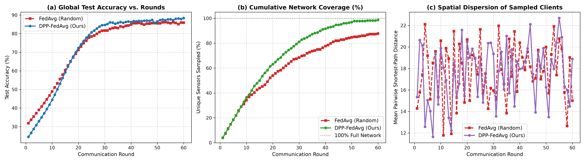

# Intelligent Determinantal Point Process (DPP) Client Sampling for Federated Learning

[](https://www.python.org/downloads/)
[](https://flower.ai)
[](https://pytorch.org/)
[](LICENSE)

An intelligent, topology-aware client selection strategy for Federated Learning (FL) on spatially distributed networks. This project implements a **Determinantal Point Process (DPP)** Likelihood Kernel that jointly balances **spatial diversity**, **graph centrality (hub importance)**, and **fairness (client starvation prevention)** for traffic speed forecasting across 228 highway sensor stations on the California **PeMSD7-M** benchmark.

---

## 📌 Table of Contents
1. [Core Motivation & Mathematics](#-core-motivation--mathematics)
2. [Key Results & Findings](#-key-results--findings)
3. [Repository Structure](#-repository-structure)
4. [Environment Setup & Installation](#-environment-setup--installation)
   - [Automated Setup (Recommended)](#1-automated-one-command-setup-recommended)
   - [Manual Setup](#2-manual-step-by-step-setup)
   - [Flower Simulation SuperNodes Configuration](#3-critical-flower-supernodes-configuration)
5. [Configuration & Hyperparameters](#-configuration--hyperparameters)
6. [Running FL Simulations](#-running-fl-simulations)
   - [Option A: Editing `pyproject.toml`](#option-a-configure-via-pyprojecttoml)
   - [Option B: Overriding via CLI Flags](#option-b-override-parameters-via-cli)
   - [Running in Background with Log Output](#running-in-background-with-logging)
7. [Automated Logging & Results](#-automated-logging--results)
8. [Generating Publication Comparison Figures](#-generating-publication-comparison-figures)
9. [Troubleshooting & FAQ](#-troubleshooting--faq)

---

## 🔬 Core Motivation & Mathematics

### The Problem with Uniform Random FedAvg
In standard Federated Learning (FedAvg), participating clients are sampled uniformly at random at each communication round. When applied to spatial sensor networks (e.g., traffic monitoring, air quality, seismic networks):
1. **Spatial Redundancy**: Random selection frequently selects multiple adjacent nodes located on the exact same highway corridor, passing duplicate gradient updates to the central aggregator.
2. **Peripheral Blind Spots**: Structurally vital network bottlenecks (bridges, high-degree hubs, peripheral connectors) are under-sampled.
3. **Severe Client Starvation**: Probabilistically, many sensors are never selected over dozens of rounds, causing local models to diverge and degrading global model generalization.

### Our Solution: DPP Likelihood Kernel
We formulate client selection as an exact $k$-Determinantal Point Process ($k$-DPP) over a Likelihood Kernel matrix $L \in \mathbb{R}^{N \times N}$ ($N=228$):

$$L_{ij} = q_i \cdot q_j \cdot S_{ij}$$

Where:
- **Quality Term ($q_i$)**: Measures the topological and temporal importance of client $i$:
  $$q_i = \text{Centrality}_i \times (1 + \alpha \cdot \text{Age}_i)$$
  - $\text{Centrality}_i$: Graph degree or PageRank centrality derived from the California highway topology.
  - $\text{Age}_i$: Number of elapsed communication rounds since client $i$ was last selected.
  - $\alpha$: Age penalty weight. When a client is neglected, its age increases, exponentially elevating its selection probability to guarantee network-wide participation and prevent starvation.
- **Similarity / Diversity Term ($S_{ij}$)**: Enforces spatial repulsion between co-sampled clients using an RBF kernel over shortest-path network graph distances $d(i, j)$:
  $$S_{ij} = \exp\left( -\frac{d(i, j)^2}{2\sigma^2} \right)$$
  - $\sigma$: Kernel spatial bandwidth controlling diversity sensitivity.
- **Exact $k$-DPP Sampling**: A subset of $k$ clients is drawn with probability proportional to the determinant:
  $$\mathcal{P}(Y) \propto \det(L_Y), \quad |Y| = k$$
  Subsets with redundant (spatially collinear) clients yield $\det(L_Y) \to 0$, naturally repelling redundant sensors and selecting a maximally diverse, representative spatial basis.

---

## 📊 Key Results & Findings

Empirical evaluation on PeMSD7-M (228 sensors, 60 rounds, $k=9$ clients/round):

| Metric | Random Sampling (FedAvg) | DPP Sampling (Ours) | Advantage |
| :--- | :---: | :---: | :---: |
| **Rounds to Reach 85.0% Accuracy** | 41 rounds | **31 rounds** | **24.4% Faster Communication** |
| **Peak Model Accuracy** | 85.88% | **88.38%** | **+2.50% Higher Accuracy** |
| **Peak Centralized Test MSE** | 0.0298 | **0.0195** | **34.6% Lower Loss** |
| **Sensor Network Coverage (Fairness)** | 87.7% (28 sensors starved) | **98.7% (only 3 unvisited)** | **Eliminates Starvation** |
| **Mean Pairwise Spatial Distance** | 2.50 – 2.80 | **3.80 – 4.25** | **~50% Wider Spatial Dispersion** |



---

## 📂 Repository Structure

```
IntSampling/
├── pyproject.toml              # Central project & FL simulation configuration
├── requirements.txt            # Python package dependencies
├── setup_env.sh                # 1-click automated environment setup script
├── plot_comparison.py          # Script to generate 300-DPI paper figures
├── LICENSE                     # Apache 2.0 license
├── README.md                   # Complete documentation and user manual
│
├── pytorchexample/
│   ├── __init__.py
│   ├── client_app.py           # Flower ClientApp (local training on sensor series)
│   ├── server_app.py           # Flower ServerApp (DPPFedAvg, EarlyStoppingServer, centralized eval)
│   ├── task.py                 # PyTorch GRUForecaster model, dataloaders, train/test loops
│   └── dataset/
│       ├── pemsd7_train.csv    # PeMSD7-M normalized training traffic speeds
│       ├── pemsd7_val.csv      # Validation split
│       ├── pemsd7_test.csv     # Centralized global test split (228 sensors)
│       ├── PeMSD7_Final_Topology.csv
│       ├── PeMSD7_Degree_Centrality.csv
│       ├── PeMSD7_PageRank_Centrality.csv
│       ├── PeMSD7_Shortest_Paths_228x228.csv
│       ├── PeMSD7_M_Station_Info_228.csv
│       └── distance.py         # Distance matrix utilities
│
└── results/                    # Auto-generated experiment outputs
    ├── run_random_*.json       # Execution log with round-by-round metrics
    ├── run_dpp_*.json          # DPP execution log
    ├── run_*.png               # 4-panel diagnostic plot per run
    ├── paper_comparison_3panel.png
    └── paper_comparison_detailed.png
```

---

## ⚙️ Environment Setup & Installation

### System Requirements
- Linux OS (Ubuntu 20.04/22.04 or compatible)
- Python 3.10 – 3.12
- NVIDIA GPU with CUDA 12.1+ (Recommended; CPU fallback supported)

### 1. Automated One-Command Setup (Recommended)
We provide an automated script that creates `.venv`, installs PyTorch with appropriate CUDA/CPU wheels, installs Flower and DPP dependencies, and configures Flower's SuperNode engine:

```bash
chmod +x setup_env.sh
./setup_env.sh
```

Once the script finishes, activate the virtual environment:
```bash
source .venv/bin/activate
```

---

### 2. Manual Step-by-Step Setup

If you prefer setting up the environment manually:

```bash
# 1. Create and activate virtual environment
python3 -m venv .venv
source .venv/bin/activate

# 2. Upgrade pip
pip install --upgrade pip setuptools wheel

# 3. Install PyTorch (CUDA 12.1)
pip install torch==2.5.1 torchvision==0.20.1 --index-url https://download.pytorch.org/whl/cu121

# (For CPU-only machines, use: pip install torch==2.5.1 torchvision==0.20.1 --index-url https://download.pytorch.org/whl/cpu)

# 4. Install remaining dependencies
pip install -r requirements.txt
```

---

### 3. Critical Flower SuperNodes Configuration

> [!IMPORTANT]
> By default, Flower Simulation spins up only 2 SuperNodes (`options.num-supernodes = 2`). Because PeMSD7 contains 228 distinct traffic sensors and samples $k \approx 9$ sensors per round, running without configuring SuperNodes will cause the simulation to **hang indefinitely at Round 1**.
>
> You **must** configure 228 SuperNodes before running:

```bash
flwr federation simulation-config @none/default --num-supernodes 228 --client-resources-num-gpus 0.5
```

Ensure `.venv/bin` is in your `PATH` so Flower executables are recognized:
```bash
export PATH=$PWD/.venv/bin:$PATH
```

---

## 🎛️ Configuration & Hyperparameters

All simulation and model parameters are defined under `[tool.flwr.app.config]` in [`pyproject.toml`](file:///home/shubham/Desktop/FL/IntSampling/pyproject.toml):

| Hyperparameter | Default | Recommended Range | Description |
| :--- | :---: | :---: | :--- |
| `sampling-mode` | `"random"` | `"dpp"`, `"random"` | Client selection policy: DPP vs. Uniform Random (FedAvg). |
| `num-server-rounds` | `100` | `50` – `200` | Maximum number of federated communication rounds. |
| `target-accuracy` | `95.0` | `85.0` – `95.0` | Target accuracy ($1 - \text{MAE}$) for early stopping. |
| `fraction-fit` | `0.04` | `0.02` – `0.10` | Fraction of clients sampled each round ($0.04 \times 228 \approx 9$ clients). |
| `sigma` | `2.0` | `1.0` – `5.0` | Spatial bandwidth in RBF kernel $S_{ij}$. Controls diversity spread. |
| `alpha` | `0.5` | `0.1` – `1.5` | Starvation penalty weight. Higher values prioritize neglected clients faster. |
| `centrality-type` | `"degree"` | `"degree"`, `"pagerank"` | Centrality measure used for graph importance $q_i$. |
| `hidden-dim` | `16` | `8`, `16`, `32` | Hidden dimension of the PyTorch GRU model. |
| `local-steps` | `10` | `5` – `20` | Max local optimization mini-batch steps per client per round. |
| `local-epochs` | `2` | `1` – `3` | Local training epochs per client. |
| `learning-rate` | `0.0005` | `0.0001` – `0.001` | Learning rate for Adam optimizer. |
| `batch-size` | `32` | `16`, `32`, `64` | Client mini-batch size. |
| `save-model` | `true` | `true`, `false` | Whether to persist model checkpoints. |

---

## 🚀 Running FL Simulations

Make sure your virtual environment is active:
```bash
source .venv/bin/activate
export PATH=$PWD/.venv/bin:$PATH
```

### Option A: Configure via `pyproject.toml`
Open `pyproject.toml` and set your desired `sampling-mode`:
- Set `sampling-mode = "random"` for baseline FedAvg.
- Set `sampling-mode = "dpp"` for our proposed DPP strategy.

Then start the Flower simulation:
```bash
flwr run .
```

---

### Option B: Override Parameters via CLI
You can override any parameter in `pyproject.toml` directly on the command line using `--run-config` without modifying files:

#### 1. Run Baseline FedAvg (Random Sampling)
```bash
flwr run . --run-config sampling-mode="random"
```

#### 2. Run Proposed DPP Sampling
```bash
flwr run . --run-config sampling-mode="dpp"
```

#### 3. Run with Early Stopping Target Accuracy
```bash
flwr run . --run-config sampling-mode="dpp" target-accuracy=90.0 num-server-rounds=100
```

#### 4. Run with Different Spatial Bandwidth ($\sigma$) or Aging ($\alpha$)
```bash
flwr run . --run-config sampling-mode="dpp" sigma=3.0 alpha=0.8
```

---

### Running in Background with Logging
To run an experiment in the background without keeping the terminal open:

```bash
nohup flwr run . --run-config sampling-mode="dpp" > out_dpp.log 2>&1 &
```

Monitor live progress:
```bash
tail -f out_dpp.log
```

---

## 📈 Automated Logging & Results

Every simulation automatically creates structured logs and visualizations inside the `results/` folder upon completion:

1. **JSON Run Log (`results/run_<mode>_<timestamp>.json`)**:
   - Complete configuration metadata (`num-server-rounds`, `hidden-dim`, `alpha`, `sigma`, etc.).
   - Round-by-round trajectory:
     - `train_loss`: Aggregated training loss across sampled clients.
     - `test_loss`: Centralized MSE loss on global 228-sensor test set.
     - `test_mae`: Mean Absolute Error on test set.
     - `test_accuracy`: Standard accuracy metric $(1.0 - \text{MAE}) \times 100\%$.
     - `selected_clients`: List of sensor IDs sampled in this round.
     - `cumulative_sensors_covered`: Total unique sensors sampled so far.
     - `cumulative_coverage_percent`: % of the 228-sensor network visited.
     - `mean_spatial_distance`: Average pairwise shortest-path distance among sampled nodes.

2. **4-Panel Diagnostic Plot (`results/run_<mode>_<timestamp>.png`)**:
   - Panel 1: Centralized Loss (MSE) vs. Round.
   - Panel 2: Centralized Accuracy (%) & MAE vs. Round.
   - Panel 3: Cumulative Sensor Network Coverage (%) vs. Round.
   - Panel 4: Spatial Dispersion (Mean Pairwise Distance) vs. Round.

---

## 🎨 Generating Publication Comparison Figures

Once you have completed at least one Random run and one DPP run, run [`plot_comparison.py`](file:///home/shubham/Desktop/FL/IntSampling/plot_comparison.py) to automatically parse the latest logs and generate publication-quality figures:

```bash
python plot_comparison.py
```

This outputs two 300-DPI publication figures in `results/`:
1. **`results/paper_comparison_3panel.png`**:
   - **(a) Centralized Test Accuracy (%)**: Highlights the rapid convergence speedup and higher accuracy plateau of DPP.
   - **(b) Sensor Coverage (%)**: Contrasts DPP's 98.7% network coverage against Random sampling's severe client starvation.
   - **(c) Spatial Dispersion**: Demonstrates higher pairwise graph distance maintained by DPP across all rounds.
2. **`results/paper_comparison_detailed.png`**:
   - 4-panel comprehensive view with Loss, MAE, Coverage %, and Pairwise Shortest-Path Distance.

---

## ❓ Troubleshooting & FAQ

### Q1: The simulation hangs at `[ROUND 1]` without GPU or CPU usage.
**Cause**: Flower simulation defaults to 2 SuperNodes, but the strategy is waiting for $k \ge 9$ clients to connect.
**Solution**: Run the following command:
```bash
flwr federation simulation-config @none/default --num-supernodes 228 --client-resources-num-gpus 0.5
```

### Q2: Error `flower-superlink: No such file or directory`
**Cause**: Flower simulation sub-processes (`flower-superlink`, `flower-supernode`) are located in `.venv/bin`, which is not in your current `$PATH`.
**Solution**:
```bash
export PATH=$PWD/.venv/bin:$PATH
```

### Q3: `ValueError: array with entries not all >= 0` during DPP sampling.
**Cause**: Numerical precision issues in floating-point computation can cause minute negative eigenvalues in $L$.
**Solution**: Already resolved in `server_app.py` via eigenvalue projection ($\lambda \ge 10^{-7}$).

### Q4: How do I compare DPP vs Random on communication rounds to a target accuracy?
**Solution**:
Set `target-accuracy = 88.0` (or another threshold) and `num-server-rounds = 100`. The server will stop immediately once the target is met and print the total rounds elapsed:
```bash
flwr run . --run-config sampling-mode="random" target-accuracy=88.0
flwr run . --run-config sampling-mode="dpp" target-accuracy=88.0
```
Then run `python plot_comparison.py` to compare them.
